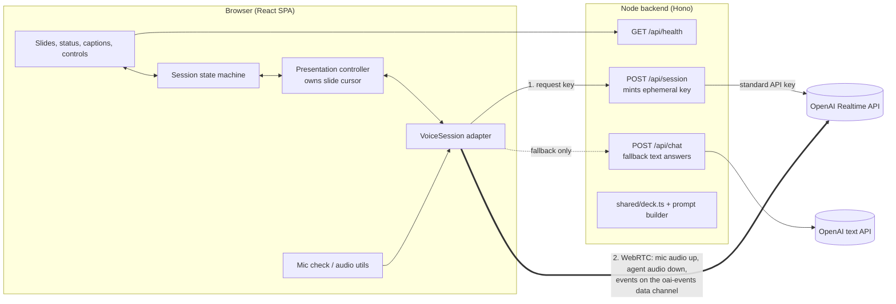

# Architecture: Voice Presentation Agent

> How the prototype is built. Product behaviour, states and targets are defined in [product-brief.md](product-brief.md), and this document refers to its sections as "brief §N".
> Key decisions are recorded in [decisions/](decisions/). Start with [ADR 0001](decisions/0001-realtime-voice-architecture.md).

## 1. Context and constraints

- **Optimise for interaction quality** over breadth. The hard targets (brief §9), measured in the browser from what the reviewer does to what they hear: Ava's audio stops within ≤ 150 ms of a talk press (phase 1) or ≤ 300 ms of the reviewer starting to speak (phase 2), and the first answer audio arrives at p50 ≤ 1.5 s.
- **Lightweight.** One small Node backend and one React single-page app. No database, no auth, no media server.
- **Reviewer-first.** One `npm install` and `npm run dev` plus a single API key. Desktop Chrome is the tested submission baseline. Other browsers are best-effort until their acceptance checks are run and recorded.
- **Never a dead end** (brief §10). Every failure has a working next step, and the demo can finish without a mic, and even without the realtime voice service.

## 2. System overview



- **Audio and events go straight from the browser to OpenAI** over WebRTC, so no media passes through our server. WebRTC gives us Opus encoding, jitter buffering and the browser's echo cancellation.
- **The backend does three things.** It keeps the API key secret, builds the session config (instructions, tools, voice and turn detection) from the shared deck, and serves the fallback text endpoint.
- **The deck is code** (`shared/deck.ts`), imported by both sides. The client renders slides from it, and the server builds the agent's grounding from it.

## 3. Voice stack

**OpenAI Realtime API over WebRTC, behind a provider-neutral `VoiceSession` adapter.** The rationale and the alternatives considered are in [ADR 0001](decisions/0001-realtime-voice-architecture.md).

| Setting | Value (env-overridable) | Why |
|---|---|---|
| Model | `OPENAI_REALTIME_MODEL`, default `gpt-realtime-2.1` | Speech-to-speech, so no separate transcription and speech-synthesis steps add latency. `gpt-realtime` is deprecated (shutdown 2027-01-20) with `gpt-realtime-2.1` as the recommended replacement. |
| Voice | `OPENAI_REALTIME_VOICE`, default `marin` | A calm, clear voice that suits the persona (brief §6). The voice can't change once the session has produced audio. |
| Turn detection | **Phase 1 (tap-to-talk):** `null`, and the client commits each turn. **Phase 2+ (hands-free):** `semantic_vad`, `interrupt_response: true`, **`create_response: false`** | Tap-to-talk gives clean, explicit turns first ([ADR 0003](decisions/0003-turn-taking-tap-to-talk-first.md)). Hands-free adds server-side barge-in, with semantic end-of-turn to reduce cut-offs mid-thought. `create_response` stays off so the client remains the only creator of responses (§5.1). |
| Input transcription | `gpt-4o-mini-transcribe` | Captions of what the reviewer said (brief §7.4). Transcription runs asynchronously, so the reviewer's caption can arrive after Ava starts answering. |
| Transport | WebRTC (`/v1/realtime/calls`, SDP exchange) | Lowest latency in the browser, and the server truncates unplayed audio on interruption. |
| Session limit | 60 minutes per Realtime session | Treated as a planned reconnect (§10.2). |

## 4. The `VoiceSession` adapter

Provider-specific events stay inside `web/src/voice/<provider>/`. The controller owns all decisions; adapters only execute commands and normalize events.

| Command | Contract |
|---|---|
| `connect({ mic, signal })` / `close()` | Open or dispose the transport; closing is idempotent. |
| `createResponse(request)` | Send one controller-authorized response with request metadata, instructions and tool policy. Used for narration, answers and tool continuations. |
| `sendUserText(text)` | Append a user message only; does not start inference. |
| `sendToolResult(callId, output)` | Append a function result only; does not start inference. |
| `interrupt()` | Mute the output gate immediately, cancel pending/active generation and clear queued playback. Resolve only when cancellation/clearing is acknowledged or the old transport is closed. A bounded timeout enters recovery. |
| `beginUserTurn()` | Interrupt immediately, clear previous input and enable the mic for a new explicit turn. |
| `endUserTurn({ cancel })` | On send: allow a cancellable 150 ms tail, disable the mic, commit input and report readiness. On cancel: disable the mic immediately, clear input and cancel all send timers. Neither path creates a response. |
| `setMicEnabled(enabled)` / `setTurnMode(mode)` | Update capture and turn detection; hands-free keeps `create_response: false`. |
| `on(listener)` / `agentAudio` | Subscribe to normalized events; expose received audio for visualization, not as proof of audible playback. |

Each event includes `sessionEpoch`; turn-related events include `turnId`; response events include the actual provider `responseId`. Keep request IDs in response metadata and user item IDs in transcript events. Do not guess an event's response by assigning it to the newest response.

| Provider event | Adapter meaning |
|---|---|
| `response.created` | Generation started for a reserved request |
| `response.done` | Generation terminal: completed, cancelled, failed or incomplete; **not playback completion** |
| `output_audio_buffer.started` | Playback started for that response |
| `output_audio_buffer.stopped` | Provider output drained; reconcile with the local output gate/playback tail before reporting playback complete |
| `output_audio_buffer.cleared` | Playback was interrupted; never advance narration |
| `response.output_audio_transcript.delta` | Generated caption text; may lead playback and is not a word-level playback clock |
| `conversation.item.input_audio_transcription.*` | Asynchronous user transcript keyed by item ID |
| `response.function_call_arguments.done` | Tool request attached to its response and turn |
| `input_audio_buffer.speech_started` / `speech_stopped` | Hands-free input boundaries; controller schedules the answer after input commit |

Implement `OpenAIRealtimeSession`, `FallbackSpeechSession` and a deterministic `FakeVoiceSession` behind this contract. Browser speech reports completion from its utterance lifecycle; all adapters distinguish completion from interruption.

The [Realtime client reference](https://developers.openai.com/api/reference/resources/realtime/client-events) documents response-level instruction overrides. The [conversation guide](https://developers.openai.com/api/docs/guides/realtime-conversations) documents WebRTC cancellation and output clearing, and the [server reference](https://developers.openai.com/api/reference/resources/realtime/server-events) distinguishes generation from output-buffer completion. Pin payload types and event mappings in the adapter. The first spike must verify event ordering, clear acknowledgements and the local playback tail against the chosen model/browser; do not infer timing guarantees from event names.

## 5. Client state machine

XState v5 owns the session state and control availability. Its parallel concerns are connection, voice backend, agent activity, input mode and presentation activity. The controller owns the explicit presentation context described in §6.4.

```
setup: landing → micCheck → ready
       landing → ready (typing)
live (parallel)
 ├─ connection: connecting | connected | reconnecting | failed
 ├─ voice: live | backup | offline
 ├─ agent: idle | listening | thinking | speaking | paused(user | typing)
 ├─ input: voice | text
 └─ presentation: narrating | answering | awaitingResume | finished
ended: connections closed, microphone released, timers cancelled
```

`turnMode` is `tapToTalk` or `handsFree`. Presentation status (`running`, `paused`, `finished`) persists independently of a temporary answer activity. A question asked while paused returns to paused; a question after completion returns to finished.

Status priority is: ended; blocking setup/recovery error; offline capability notice; paused; speaking/thinking/listening; finished; idle. Retry attempts in the background must not hide working backup playback. Labels reflect available inputs: text-only and backup modes never instruct the reviewer to hold Space. Hands-free labels invite speech; tap-to-talk labels explain the press. The backup tag remains visible while speaking. Captions come from the transcript log but are marked interrupted when playback is cancelled; generated transcript text is not treated as exactly what the reviewer heard.

### 5.1 Response and question ownership

1. Only the controller calls `createResponse`. Reserve the generation slot **before sending** the request, with `{ requestId, sessionEpoch, turnId }`. This closes the race before `response.created` arrives.
2. Track `generatingResponse` (including pending creation) separately from `playingResponse`. A generation terminal event releases the generation slot, not the playback slot or narration checkpoint. The baseline starts no new narration until the preceding playback finishes.
3. A user question is one turn spanning input commit, any tool calls/results, follow-up generation and final answer playback. A tool-only `response.done` does not finish the question or start auto-resume.
4. Tool results are acknowledgements only. Collect and validate calls from the current response, return each result once, then schedule at most one continuation after generation and any audio from that response have finished. For `resume_presentation`, acknowledge and schedule narration instead of an answer continuation, after the same completion barrier. In finished mode, acknowledge a no-op unless the user explicitly requested Resume/Restart.
5. Require a continuation after a navigation tool unless that response already supplied the complete answer and no unresolved calls remain. An ambiguous lead-in is not a complete answer. Invalid tools get a validated error result; bound recovery to two continuation attempts, then show Retry rather than loop indefinitely.
6. The question ends only after final answer playback completes and no tools or continuations remain. Then enter `awaitingResume` if running, or restore paused/finished status. A legitimate no-audio final result is handled explicitly; failed/incomplete generation offers Retry and does not advance narration.
7. Interrupt invalidates pending creation and the old turn's work. Wait for generation termination and output-clear acknowledgement before issuing replacement speech. Accept any terminal generation status in a completion/cancellation race, not just `cancelled`. On timeout close the old transport and recover. Keep output muted until the old playback is cleared; unmute only for authorized replacement playback.

### 5.2 Stale events and teardown

Advance `sessionEpoch` on reconnect, backend swap and End. Invalidate the previous epoch before disposing its connection, listeners and timers. Reject its callbacks, including disconnect and delayed user transcription events.

Within an epoch, maintain a response registry with turn ownership and separate generation/playback status. Accept completion/clear acknowledgements for a cancelling response to release its barriers, but suppress its late captions, tools and navigation. Never discard legitimate playback events solely because another generation ID exists. A cancelled pending request's eventual `response.created` is cancelled rather than adopted. Tool call IDs are deduplicated.

### 5.3 Timers and controls

Timers are scoped to a session epoch and turn. End, reconnect, navigation and cancellation dispose dependent timers. Delays in parallel regions need explicit guards; pausing another region does not automatically pause an XState timer.

| Timer | Rule |
|---|---|
| Accidental Space press, <300 ms | Classification on release only; cancellation of Ava already happened on press. Orb clicks are intentional toggle gestures, not accidental holds. |
| Mic tail, 150 ms | Cancel on Esc, blur, hidden document, new turn, navigation, End or reconnect; no late commit is allowed. |
| Orb turn, 30 s | Auto-send; a second click sends earlier. Esc/focus loss cancels. |
| Thinking, 4 s warning / 10 s timeout | Measured across the unanswered question, including tool-only continuations; do not reset for every tool result. Timeout cancels work before offering Retry. |
| Resume, 1.5 s | Starts after the final audible answer ends. Cancel on typing, talk, pause, navigation, End or recovery. Resume only when presentation status is running. |
| Empty input | A confirmed empty committed turn returns to the saved status; missing asynchronous transcription alone is not proof of silence. Never race a started answer with automatic narration. |
| Reconnect/clear timeout | Bounded; close the old transport and offer recovery if acknowledgements never arrive. |

Focus loss (`blur` or document becoming hidden), Esc and pointer cancellation always cancel capture without submitting. Lost focus leaves presentation paused until explicit Resume. End immediately mutes/cancels, closes transports, releases every mic track, cancels browser speech and timers, and enters `ended`. A visual closing line is optional; cleanup never waits for generated farewell audio.

## 6. Presentation controller: client-driven cursor

The central design choice is that **the browser owns where we are in the talk, and the model never decides what comes next in the narration.** The model speaks the segment it is given, answers questions, and asks to change slides through tools. Resume, reconnect, pause and the fallback all depend on this (see ADR 0001).

### 6.1 Deck data model (`shared/deck.ts`)

```ts
export type SlideId = "intro" | "mechanism" | "uses" | "evidence" | "safety" | "future";

export interface Slide {
  id: SlideId;
  title: string;
  bullets: string[];            // on-screen text
  visual: VisualKey;            // inline SVG component key (scientific diagram, drawn to scale)
  segments: string[];           // spoken script, 1 sentence each (~4–7 s)
  facts: { id: string; text: string; sourceIds: string[] }[]; // grounding for Q&A, never shown verbatim
  sources: { id: string; label: string; url: string; accessed: string }[]; // shown in small print on the slide
  statusAsOf?: string;          // for approval/pipeline content that can change
  keywords: string[];           // hints for which questions map to which slide
}
```

Fact and source ids make every number traceable from the prompt back to a citation, and let a unit test fail if a fact references a missing source.

Each segment is one sentence. Resume repeats the interrupted sentence with an optional short bridge. The checkpoint is based on completed playback, not generated transcript text; partial repetition is intentional.

### 6.2 Narration loop

1. Show the checkpoint's slide and request exactly one sentence, with `tool_choice: "none"`. Response instructions include persona, reviewed-content boundaries, safety rules and the script. They replace session instructions, so never send only a script override.
2. Keep the checkpoint on that sentence while generating **and** playing it. A completed generation is only permission to await the remaining playback.
3. After successful playback completion, advance the checkpoint to the next sentence and request it without an artificial delay. Change slides only when their narration is about to begin.
4. After the last sentence, play the recap and final-question invitation as explicit narration segments. Mark the presentation finished only after their playback ends. Leave a valid checkpoint at the final slide's first sentence for an explicit Resume; do not automatically narrate it. Restart always selects slide 1.

Start with no prefetching. Measure sentence gaps against brief §9. If gaps are unacceptable, record a separate optimization decision with a bounded prefetch queue, playback-based checkpoints and cancellation of every queued sentence. Do not switch to whole-slide generation on the assumption that transcripts provide exact sentence/audio alignment.

### 6.3 Tools

| Tool | Args | Controller behavior |
|---|---|---|
| `goto_slide` | `slide_id: SlideId`, `intent: "answer" | "user_request" | "stay"` | Validate against deck IDs. `answer` changes only `displayedSlide`. `user_request` and `stay` call the shared checkpoint replacement operation (§6.4). A `stay` destination must be the displayed slide. Acknowledge `{ ok, slide_title }`; do not create a response inside the tool handler. |
| `resume_presentation` | none | For an active talk, request resume after the tool lifecycle completes. In finished status it is a no-op unless the turn explicitly requests Resume/Restart. Restart is a separate explicit command resetting to slide 1. |

Ask the model to navigate before giving substantive answer audio. The controller renders the validated destination before scheduling a tool continuation. Measure the added round trip. A short lead-in in a mixed audio/tool response is allowed, but is not by itself a completed answer. User text is never executable navigation; all tool arguments are validated.

### 6.4 Checkpoint and resume contract

One controller context contains:

| Field | Meaning |
|---|---|
| `displayedSlide` | The slide currently visible, including temporary Q&A jumps |
| `narrationCheckpoint: { slideId, sentenceIndex }` | The current unfinished sentence, or next sentence after successful playback |
| `presentationStatus: running | paused | finished` | Whether automatic narration is allowed; independent of temporary Q&A |
| `questionTurn` | Turn ID, question, pending tools/continuations and pre-question status |

There is no independent `returnTo` or `interruptedAt` cursor. All entry points use the same operations:

- **Ask (voice, typed, chip):** preserve the checkpoint before cancelling playback. Follow-ups keep it. Typing records pre-typing status; clearing the input restores that status rather than resuming a deliberately paused talk.
- **Answer navigation:** change only `displayedSlide`. After final answer playback, running status starts the 1.5-second window, then returns to the checkpoint slide and narrates its sentence with a brief bridge.
- **Manual or explicit voice navigation:** replace the checkpoint with destination sentence 0 and update the displayed slide. Cancel obsolete turns/timers. Running continues there; paused stays paused; finished stays finished until explicit Resume/Restart.
- **Stay here:** replace the checkpoint with the displayed slide's sentence 0. Preserve current status; an active answer may finish before running narration resumes from that checkpoint.
- **Interrupted bridge:** keep the checkpoint until the sentence itself has completed playback; never clear it just because a response started.
- **Paused question:** answer, restore the checkpoint slide, then remain paused. A cancelled answer offers Ask again; it is not silently replaced with narration.
- **Finished question:** answer without restarting the talk; a temporary answer jump returns silently to the displayed slide saved at question start. Explicit navigation can change that destination. Resume explicitly sets running at the selected checkpoint; Restart resets everything to slide 1.

### 6.5 Manual controls

| Control | Effect |
|---|---|
| Space held | Interrupt and capture; release sends after the cancellable tail. A hold <300 ms cancels capture and restarts the interrupted sentence only if previously running. |
| Orb click/tap | Start capture, second click/tap sends. No duration-based hold gesture on the orb. |
| Pause (`P`) | Immediate interruption; preserve checkpoint and set paused. Resume restarts its sentence. If an answer was cancelled, offer Ask again. |
| Typing | Pause on first keystroke; submission uses the shared Ask operation. Clearing restores pre-typing status. |
| Arrows, `1`–`6`, slide dots | Shared explicit navigation operation; no out-of-range navigation. |
| Stay here (`S`) | Shared checkpoint replacement operation. |
| End (`Shift+E`) | Immediate teardown (§5.3), including during recovery or errors. |
| Mute (`M`, hands-free) | Disable capture and offer typed input; do not stop playback. |
| `/`, `R`, `?` | Focus question box, retry visible failure, show shortcut help. |
| Esc / focus loss | Cancel capture and timers without submission. Focus loss remains paused; Esc restores prior status when safe. |

Ignore repeated keydown events. Global shortcuts must not override typing, editable content, native button activation or modal controls. All actions are also reachable by Tab and have visible focus indicators.

## 7. Agent prompt and grounding

The server builds this in `server/src/prompt.ts` from `shared/deck.ts`:

1. **Persona and style:** Ava, a medical educator. Answers run 1–3 sentences and offer more detail rather than giving it unasked (brief §6).
2. **Deck map:** each slide's id, title and keywords, so `goto_slide` targets are obvious.
3. **Facts:** all slide `facts` with their ids and source labels. Answer only from reviewed deck facts, keeping numbers exactly as given with trial, dose and duration. If the answer is absent, explain that this demo does not cover it and offer a relevant reviewed topic; do not supplement with general medical knowledge.
4. **Guardrails:**
   - **Personal medical questions:** give only relevant reviewed general information, then refer the reviewer to a clinician.
   - **Off-topic questions:** one sentence, then a bridge back.
   - **Uncertainty:** say "I don't know" rather than guess.
   - **Brands:** use generic names first.
5. **Tool rules:** when to call `goto_slide` (and with which intent) and when to call `resume_presentation`.

The session instructions hold items 1–5. The prompt builder exposes one function per use, so every path gets the same persona and guardrails:

| Use | Built from |
|---|---|
| Session instructions (Q&A) | Items 1–5 |
| Narration response instructions (§6.2) | Items 1 and 4, the reviewed-content boundary from item 3, plus the script, resume and return lines. No tools. |
| Reconnect seed (§10.2) | Trusted system message: checkpoint, displayed slide, status, covered slides, "Do not re-greet." Replay up to 3 completed Q&A pairs separately with original user/assistant roles; omit unplayed assistant text. |
| `/api/chat` (backup voice, §10.3) | Items 1–5, with tools expressed as structured output |

The total size stays well within limits: the detailed deck is about 4–6k tokens. A prompt-builder snapshot test plus a set of about 25 golden questions (on-deck, cross-slide, personal advice, off-topic, out-of-deck medical, trick numbers) with expected slide and must/must-not phrases guard the grounding rules.

## 8. Audio

- **Mic capture:** `getUserMedia({ audio: { echoCancellation: true, noiseSuppression: true, autoGainControl: true, deviceId } })`. One stream is shared by the mic check and the session, so permission is asked once (brief §7.2–7.3).
- **Mic check:** an `AudioContext` + `AnalyserNode` measures RMS level. Speech is detected when the level stays above the threshold for about 300 ms. The 6 s no-input timeout leads to the help options. `enumerateDevices()` fills the picker after permission is granted, and `devicechange` keeps it up to date.
- **Agent audio:** the remote WebRTC track plays through an `<audio autoplay>` element. A second `AnalyserNode` on `agentAudio` drives the speaking waveform. The Start click unlocks autoplay. If `play()` still rejects, a "Tap to enable sound" prompt appears.
- **Text mode with no mic:** the peer connection is created with `addTransceiver("audio", { direction: "recvonly" })` and `turn_detection: null`, so the agent still speaks.
- **Mic lifecycle:** in phase 1 the mic track is enabled only during a Space hold, an open orb-toggle turn and its cancellable tail. End stops every track. Browser recording indicators vary when a track is disabled; do not use the indicator as the turn state. A track `ended` event or the active device disappearing on `devicechange` switches `input → text` with the notice "Your microphone disconnected". Picking another device mid-session replaces the sender track and stops the old one. Returning from a receive-only text connection requires enabling an outgoing audio transceiver and renegotiating or reconnecting; do not assume a sender already exists.
- **Local output mute:** the `<audio>` element can be muted instantly on the client. This is what makes the ≤ 150 ms stop target independent of network round trips (§9).
- **Reduced motion:** the visualisers fall back to static icons (brief §11).

## 9. Interruptions

Turn-taking ships in phases ([ADR 0003](decisions/0003-turn-taking-tap-to-talk-first.md)): **tap-to-talk**, then **hands-free**, then a **hybrid** toggle.

**Phase 1: tap-to-talk mechanics** (`turn_detection: null`)

1. On Space down or the first orb click, preserve the checkpoint and immediately mute, cancel generation and clear old output. Clear previous input and enable the mic. There is no 300 ms deferred-cancellation period.
2. Keep output gated until the old clear/termination barrier completes. Do not unmute merely because cancellation was sent. The new answer becomes audible only after old playback is cleared.
3. On Space release (hold ≥300 ms) or second orb click, allow the cancellable 150 ms tail, disable the mic and commit. The controller creates the answer only after input commit and cancellation barriers are satisfied.
4. A Space press <300 ms cancels input, disables the mic and clears timers/buffer. If previously narrating, restart the checkpoint sentence; if paused/finished, stay so. If an answer was interrupted, offer Ask again. Orb taps are intentional start/send gestures and do not use the accidental-hold rule.
5. Esc, blur, hidden document, pointer cancellation, navigation, End or reconnect disable capture and cancel pending send timers. Focus loss never submits and leaves the talk paused. Orb capture auto-sends at 30 seconds unless cancelled.
6. Use documented WebRTC output clearing for truncation. A local mute can precede server acknowledgement, so do not claim an exact locally heard transcript from server history. Keep sentence-based checkpoints and mark interrupted captions conservatively. Do not derive `audio_end_ms` from wall-clock elapsed time; if protocol truncation fails in the spike, stop and resolve the adapter contract before shipping.

**Phase 2+: hands-free** uses the rows below.

| Concern | Handling |
|---|---|
| Detecting barge-in | Server `semantic_vad` raises `speech_started`, and the server cancels the in-flight response. Over WebRTC the server truncates the agent's message to the audio actually played, so the history reflects only what the reviewer heard. |
| Fast visual feedback | The status flips to *Listening…* on `speech_started`, without waiting for audio to stop. |
| Self-interruption (echo) | Browser echo cancellation, plus a headphone tip on the mic-check screen. Semantic VAD eagerness controls end-of-turn timing, not echo sensitivity. Test real speakers and headphones; keep tap-to-talk available and default to it if hands-free fails the release gate (ADR 0003). |
| False interruptions (cough, "mm-hm") | The model calls `resume_presentation` (§6.3). Only confirmed empty input or an explicit resume tool may restore narration after outstanding work is cancelled. A delayed transcript alone must not trigger resume. |
| Typed interruption | `interrupt()` (`response.cancel` + `output_audio_buffer.clear`), then send the text. |

**What we measure** (the debug overlay, `?debug=1`). Server events arrive after network and VAD delay, so they don't show what the reviewer experiences. Measure the mic and the actual playback path. Use an output gate in the audible route and meter downstream of its gain/mute, or explicitly account for element mute, playback state and device buffering. An analyser on raw `agentAudio` still sees audio while the element is muted and is not a valid silence measurement. Browser timings are proxies; validate acoustic delay with an external recording in real-device QA. Distinguish brief in-sentence silence from response playback completion:

| Metric | Start | End |
|---|---|---|
| Barge-in (tap) | Space `keydown` / first orb activation | Post-gate output silent (with playback/device delay checked in QA) |
| Barge-in (hands-free) | Mic level crosses the speech threshold | Post-gate output silent (with playback/device delay checked in QA) |
| Response latency | `Space` up (tap) or mic level drops below threshold (hands-free) | First non-silent post-gate output frame |
| Slide sync | First audible answer frame | Slide transition finished |
| Narration gap | Agent audio goes silent at the end of a sentence | Next non-silent frame |
| Tool round trip | `goto_slide` received | Follow-up response's first audio |

The overlay shows p50 and p90 per metric, and a "Copy as JSON" button so the README can quote measured numbers. Each event is also logged with `performance.now()`.

## 10. Failures and recovery

### 10.1 Error taxonomy → UI (brief §10)

Four failure classes behave differently, because the backend is not in the audio path:

| Class | Live session | `/api/session` | `/api/chat` | Result |
|---|---|---|---|---|
| **Input** (mic) | Up | Up | Up | Text mode; live voice continues |
| **Voice service** (OpenAI Realtime) | Down | Up | Up | Reconnect, then backup voice |
| **Backend** | Unaffected while connected | Down | Down | At reconnect, use working local speech or readable scripts; questions are paused |
| **Network** (all) | Down | Down | Down | Offline mode (§10.4) |

| Code | Class | Source | UI | Recovery |
|---|---|---|---|---|
| `mic_denied` | Input | `NotAllowedError` | Steps to re-enable the mic for this browser | Retry, or text mode |
| `mic_not_found` | Input | `NotFoundError` / no devices | "No microphone found" | Device picker, Retry, or text mode |
| `mic_silent` | Input | Mic check timeout | Mute/device tips | Picker, Retry, or text mode |
| `mic_lost` | Input | Track `ended`, or active device removed | "Your microphone disconnected" | Automatic text mode; picker; Try microphone again |
| `not_configured` | Backend | `/api/health` → `configured: false`, or OpenAI returns 401 when minting | Banner on the landing screen with the README link | Fix `.env` |
| `quota` | Backend | OpenAI returns 429 `insufficient_quota` when minting | "The API key has no credit left" | Fix billing |
| `backend_unreachable` | Backend | Timed endpoint probes fail; `navigator.onLine` is only a hint | "Our server isn't responding" | Retry; local speech if available, otherwise readable scripts |
| `session_failed` | Voice service | SDP exchange fails, or OpenAI 5xx when minting | *Can't connect to the voice service* | 2 automatic retries (0.5 s, 2 s), then Retry or **Continue with backup voice** |
| `connection_lost` | Voice service | Peer connection `failed`, or `disconnected` for more than 3 s, or data channel closed | *Connection lost — reconnecting…* | §10.2 |
| `offline` | Network | `offline` event, or fetches fail with `navigator.onLine === false` | *You're offline — questions are paused* | §10.4; recovers on `online` |
| `response_timeout` | Voice service | `thinking` for more than 10 s | *That took too long* | Retry the last question |
| `autoplay_blocked` | — | `audio.play()` rejects | *Tap to enable sound* | One click |
| `rate_limited` / `server_error` | Voice service | `error` event | Plain-language message | Retry |

Expected protocol errors are not shown to the reviewer: `response.cancel` with no active response, and committing an empty input buffer, are logged in debug mode only. `/api/health` checks only that a key is present; a bad key is caught when `/api/session` mints and gets a 401.

### 10.2 Reconnect

A dropped Realtime session can't be reattached, so reconnect means a new session with re-seeded context.

1. Snapshot displayed slide, narration checkpoint, presentation status and pending question. Invalidate the old session epoch, cancel callbacks/timers, disable capture and close its transport before activating a replacement. Drop a held turn with "That question was lost in the reconnect — ask again".
2. Get a new client secret and a new peer connection, with the same backoff as `session_failed`.
3. Seed trusted recovery instructions separately from conversation content (§7). Replay completed Q&A in their original user/assistant roles. Never promote user text or model answers into a system message; exclude unplayed portions and pending tool transactions.
4. **Restore the state the presentation was in:**

| State before the drop | After reconnect |
|---|---|
| `narrating` | Narrate from the interrupted segment with "We're back" resume context |
| `paused` | Stay paused; nothing is spoken until Resume |
| `answering` | Notice with **Ask again** (resends the question); no narration until it is answered or dismissed |
| `awaitingResume` | Resume as normal (§6.4) |
| `finished` | Stay finished, silent |

The 60-minute session limit is handled proactively: at 55 minutes schedule renewal at a playback boundary or immediately while idle/paused/finished, preserving status. If no safe boundary arrives before expiry, use normal recovery and offer Ask again for an unfinished question. Do not promise an invisible renewal under all conditions.

### 10.3 Backup voice (voice service unreachable, backend reachable)

If reconnecting fails, the reviewer can **Continue with backup voice**, which swaps in `FallbackSpeechSession` (`voice = backup`):

- **Narration:** the browser's `speechSynthesis` reads the segment scripts directly. If speech is unavailable or fails, show readable scripts and Audio unavailable; do not block navigation or available typed Q&A.
- **Questions:** typed questions go to `POST /api/chat`. It uses the same prompt builder with an OpenAI text model (`OPENAI_CHAT_MODEL`) and structured output that mirrors the tools: `{ answer: string, goto_slide?: { slide_id: SlideId, intent: "answer" | "user_request" | "stay" }, resume?: boolean }`. Validate all fields and reject conflicting navigation/resume commands. The answer is spoken when speech works and is always shown as text. With no speech, leave the answer visible and require explicit Resume rather than auto-advancing before it can be read. The shared checkpoint rules apply exactly as in live mode.
- **Interruption:** `speechSynthesis.cancel()`. Typing cancels the utterance and preserves the sentence checkpoint, matching live mode; Resume restarts that sentence.
- **Status:** the label reads *Backup voice* so the downgrade is honest, and a "Try live voice again" button stays visible. The client may probe live voice every 30 s, with one attempt at a time. Successful probes do not seize playback: swap only at a sentence/answer boundary, or while paused/finished, preserving user intent. Cancel the old adapter and invalidate its epoch before activating the replacement; End cancels probes. Pending questions are never silently submitted twice.

### 10.4 Offline or backend unavailable

- Keep slides and readable sentence scripts available. Disable live questions when the required service is unavailable; retain the user's draft.
- Narrate only if a working local speech voice is available (`localService === true`). If none exists, or speech synthesis errors, show "Audio unavailable — read the script below" and allow manual slide/script navigation. Do not promise offline audio on every browser/device.
- Restore paused/finished status rather than starting local narration unconditionally. Backend failure may leave an existing Realtime connection working; degrade only capabilities that actually failed.
- Treat `navigator.onLine` as a hint, not proof of service availability. On connectivity changes or Retry, probe required endpoints with timeouts. Return to live voice at a playback boundary using §10.2, with old callbacks/timers cancelled.
- No service-worker/offline-first installation is promised: these guarantees apply to an already loaded app.

### 10.5 End and resource cleanup

End is available during connection, playback, input, errors and recovery. It invalidates the epoch, mutes output, stops all mic tracks, closes transports, aborts fetches/probes, cancels speech synthesis and timers, and releases audio resources immediately. Show a visual thank-you message. Do not request remote farewell audio or wait for network acknowledgements before releasing devices.

## 11. Security

- **Key handling:** `OPENAI_API_KEY` lives only in the server `.env`. The browser only ever receives a **short-lived client secret**, created by `POST /v1/realtime/client_secrets` with the full session config built server-side and `expires_after` of 60 s. The expiry limits only session creation (the session itself continues), so every reconnect mints a new secret.
- **Token-route abuse:** `/api/session` and `/api/chat` share an in-memory per-IP rate limit (for example 10/min) and a request body size cap.
- **CORS** is restricted to the app origin. In dev, Vite proxies `/api`, so everything is same-origin.
- **Nothing stored:** no audio, transcripts or personal data are kept on the server. Transcripts live only in browser memory for the session.
- **Validation:** tool arguments and `/api/chat` input are validated with Zod. Unknown slide ids are rejected with a tool error the model can recover from.
- **Known prototype limit:** a client holding the secret can send its own `session.update` (the docs confirm client config overrides). That's acceptable here. The fix is a server sideband connection (`wss://api.openai.com/v1/realtime?call_id=…`, using the call id from the SDP response's `Location` header), which is documented for WebRTC today and works from this Node server; it does not depend on the production migration in ADR 0002.
- **Logging:** the server logs never include keys, transcripts or SDP.

## 12. Tech stack

| Layer | Choice | Why |
|---|---|---|
| Frontend | Vite + React 18 + TypeScript | Fast dev loop and a small build |
| Styling and motion | Tailwind CSS + Framer Motion | Polished slide transitions and status animations with little code |
| State | XState v5 | Parallel regions and timeouts are explicit and testable |
| Validation | Zod (shared) | Tool arguments, API payloads |
| Backend | Node 24 LTS + Hono (TypeScript) | A small server with three routes. One toolchain and shared types for the prototype. Python/Pipecat is a conditional future option, see [ADR 0002](decisions/0002-backend-node-now-python-for-production.md). |
| Voice | OpenAI Realtime (WebRTC), plain `RTCPeerConnection` | No SDK lock-in, so the adapter stays thin |
| Tests | Vitest + Playwright | Unit tests for the machine and controller, end-to-end tests with a fake mic |

## 13. Planned repository layout

```
package.json            # npm workspaces; `dev` runs web + server concurrently
.env.example            # OPENAI_API_KEY, OPENAI_REALTIME_MODEL, OPENAI_REALTIME_VOICE, OPENAI_CHAT_MODEL, PORT
shared/
  deck.ts               # slides, scripts, facts, sources
  schema.ts             # Zod schemas: tools, /api/chat
server/
  src/index.ts          # Hono app, rate limit, static SPA in prod
  src/session.ts        # POST /api/session → ephemeral key
  src/chat.ts           # POST /api/chat (fallback)
  src/prompt.ts         # instructions + tool definitions from deck
web/
  src/voice/            # types.ts, openai/, fallback/, fake/
  src/machine/          # session machine + selectors
  src/presentation/     # cursor controller, narration/resume logic
  src/audio/            # mic check, meters, device list
  src/components/       # Landing, MicCheck, Stage, Slide, StatusOrb, Captions, Controls
  src/slides/visuals/   # inline SVG diagrams
  e2e/                  # Playwright specs
```

## 14. Planned running and deployment contract

The application scaffold is not implemented yet. These commands are the delivery target, not currently runnable instructions.

- **Local:** `npm install`, copy `.env.example` to `.env`, add the key, then `npm run dev`. Vite runs on `:5173` and proxies `/api` to Hono on `:8787`.
- **Production build:** `npm run build && npm start` runs one Node process that serves the built SPA and the API. It deploys as is to Render, Fly or Railway. Mic access requires HTTPS, which those hosts provide.
- **Hosted URL for reviewers:** not planned. The submission is a GitHub repo link or a zip, and reviewers run it locally with their own key (`localhost` counts as a secure context, so the mic works over plain HTTP). Requirements: Node 24 LTS, npm 10+, desktop Chrome.

## 15. Testing

| Layer | What |
|---|---|
| Unit (Vitest) | Machine transitions, especially interruptions during narration, a tool call during an answer, checkpoint replacement and resume, follow-ups, questions after `finished`, reconnect in each state (§10.2), stale events from a cancelled response, at most one active response, and backup-voice swap. The controller is driven by `FakeVoiceSession` event scripts. |
| Unit | Status priority selector, Zod tool validation, prompt builder snapshot, every fact references an existing source |
| Golden questions | About 25 questions against the real API with expected slide and must/must-not phrases (§7) |
| E2E (Playwright) | Chrome flags `--use-fake-ui-for-media-stream --use-fake-device-for-media-stream`: the mic check passes, and Start leads to *Connecting*. With a fake adapter injected: hold `Space` → listening and agent audio stops, release → thinking, a short Space press → interrupted sentence restarts, typing → paused, chip question → slide change, mic denied → text mode, connection drop → recovery without a reload, offline → local narration, and every shortcut in brief §9. |
| Manual QA | The brief §12 acceptance checks, run against the real API on laptop speakers and on headphones. Latency is recorded from the debug overlay. |

## 16. Decision log

| ADR | Decision | Status |
|---|---|---|
| [0001](decisions/0001-realtime-voice-architecture.md) | OpenAI Realtime over WebRTC behind a `VoiceSession` adapter, with a client-driven slide cursor | Accepted |
| [0002](decisions/0002-backend-node-now-python-for-production.md) | Node + Hono backend for the prototype; Python/Pipecat only if concrete future requirements justify it | Accepted |
| [0003](decisions/0003-turn-taking-tap-to-talk-first.md) | Turn-taking in phases: tap-to-talk, which meets the interrupt requirement, then hands-free (recommended stretch goal), then a hybrid toggle | Accepted |
| — | Hosting: local only, submitted as a repo link or zip (§14) | Decided |
| — | One sentence per response, playback-driven advancement; prefetch only through a separately validated optimization (§6.2) | Accepted |
