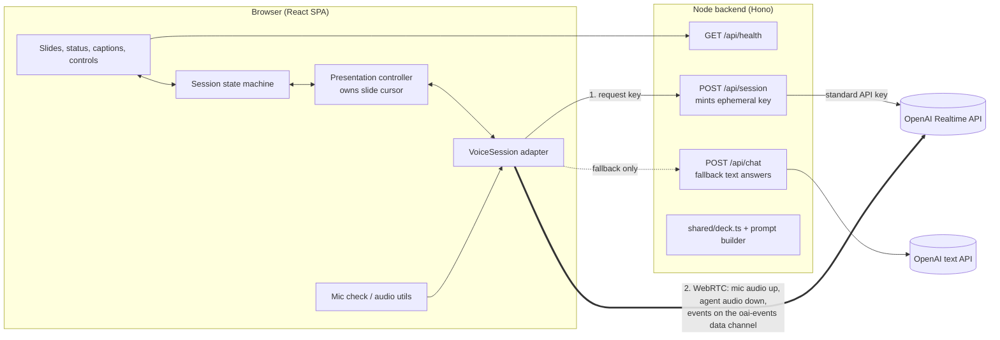

# Architecture: Voice Presentation Agent

> How the prototype is built. Product behaviour, states and targets are defined in [product-brief.md](product-brief.md), and this document refers to its sections as "brief §N".
> Key decisions are recorded in [decisions/](decisions/). Start with [ADR 0001](decisions/0001-realtime-voice-architecture.md).

## 1. Context and constraints

- **Optimise for interaction quality** over breadth. The hard targets (brief §9): Ava's audio stops within ≤ 300 ms of the reviewer starting to speak, and the first answer audio arrives within ≤ 1.5 s.
- **Lightweight.** One small Node backend and one React single-page app. No database, no auth, no media server.
- **Reviewer-first.** One `npm install` and `npm run dev` plus a single API key. Desktop Chrome is the primary target, and current Edge, Safari and Firefox should work.
- **Never a dead end** (brief §10). Every failure has a working next step, and the demo can finish without a mic, and even without the realtime voice service.

## 2. System overview



- **Audio and events go straight from the browser to OpenAI** over WebRTC, so no media passes through our server. WebRTC gives us Opus encoding, jitter buffering and the browser's echo cancellation.
- **The backend does three things.** It keeps the API key secret, builds the session config (instructions, tools, voice and turn detection) from the shared deck, and serves the fallback text endpoint.
- **The deck is code** (`shared/deck.ts`), imported by both sides. The client renders slides from it, and the server builds the agent's grounding from it.

## 3. Voice stack

**OpenAI Realtime API over WebRTC, behind a provider-neutral `VoiceSession` adapter.** The rationale and the alternatives considered are in [ADR 0001](decisions/0001-realtime-voice-architecture.md).

| Setting | Value (env-overridable) | Why |
|---|---|---|
| Model | `OPENAI_REALTIME_MODEL`, default `gpt-realtime` | Speech-to-speech, so no separate transcription and speech-synthesis steps add latency. Check the current model id at build time. |
| Voice | `OPENAI_REALTIME_VOICE`, default `marin` | A calm, clear voice that suits the persona (brief §6). |
| Turn detection | **Phase 1 (tap-to-talk):** `null`, and the client commits each turn. **Phase 2+ (hands-free):** `semantic_vad`, `interrupt_response: true`, `create_response: true` | Tap-to-talk gives clean, explicit turns first ([ADR 0003](decisions/0003-turn-taking-tap-to-talk-first.md)). Hands-free adds server-side barge-in, with semantic end-of-turn to reduce cut-offs mid-thought. |
| Input transcription | `gpt-4o-mini-transcribe` | Captions of what the reviewer said (brief §7.4). |
| Transport | WebRTC (`/v1/realtime/calls`, SDP exchange) | Lowest latency in the browser, and the server tracks playback for truncation. |

## 4. The `VoiceSession` adapter

The rest of the app never sees a provider-specific event. Everything goes through this interface (`web/src/voice/types.ts`):

```ts
export interface VoiceSession {
  connect(opts: { mic: MediaStream | null; signal?: AbortSignal }): Promise<void>;
  close(): void;

  /** Speak one scripted narration segment (client-driven cursor, §6). */
  narrate(req: NarrationRequest): void;
  /** Typed question (text mode or chip click). Interrupts current speech. */
  sendUserText(text: string): void;
  /** Stop speaking now: cancel the response and drop queued audio. */
  interrupt(): void;
  sendToolResult(callId: string, output: unknown): void;
  setMicEnabled(enabled: boolean): void;

  /** Tap-to-talk: open a user turn (interrupts the agent), then send or cancel it. */
  beginUserTurn(): void;
  endUserTurn(opts?: { cancel?: boolean }): void;
  /** Switch between explicit turns and server voice detection (phase 2+). */
  setTurnMode(mode: TurnMode): void;

  /** The agent's audio stream, for the waveform visualiser. */
  readonly agentAudio: MediaStream | null;
  on(listener: (e: VoiceEvent) => void): () => void;
}

export type VoiceEvent =
  | { type: "connected" }
  | { type: "disconnected"; reason: "network" | "server" | "closed" }
  | { type: "user_speech_started" }
  | { type: "user_speech_stopped" }
  | { type: "user_transcript"; text: string; final: boolean }
  | { type: "response_started"; responseId: string; tag: ResponseTag }
  | { type: "agent_audio_started"; responseId: string }
  | { type: "agent_audio_stopped"; responseId: string; interrupted: boolean }
  | { type: "agent_transcript"; responseId: string; delta: string }
  | { type: "tool_call"; callId: string; name: ToolName; args: unknown }
  | { type: "response_done"; responseId: string; status: "completed" | "cancelled" | "failed" }
  | { type: "error"; code: VoiceErrorCode; message: string; fatal: boolean };

export type ResponseTag =
  | { kind: "narration"; slideId: SlideId; segment: number }
  | { kind: "answer" };

export type TurnMode = "tapToTalk" | "handsFree";
```

| Implementation | Use |
|---|---|
| `OpenAIRealtimeSession` | The normal path. |
| `FallbackSpeechSession` | Used when the realtime service is unreachable (§10). `/api/chat` produces the text, and the browser's `speechSynthesis` speaks it. |
| `FakeVoiceSession` | Scripted events for unit tests and Playwright tests. |

**How OpenAI events map to adapter events** (inside `OpenAIRealtimeSession`):

| OpenAI (data channel) | Adapter |
|---|---|
| `input_audio_buffer.speech_started` / `speech_stopped` | `user_speech_started` / `user_speech_stopped` |
| `conversation.item.input_audio_transcription.delta` / `.completed` | `user_transcript` |
| `response.created` (tag read from `response.metadata`) | `response_started` |
| `output_audio_buffer.started` / `stopped` / `cleared` | `agent_audio_started` / `agent_audio_stopped` |
| `response.output_audio_transcript.delta` | `agent_transcript` |
| `response.function_call_arguments.done` | `tool_call` |
| `response.done` | `response_done` |
| `error`, `RTCPeerConnection` state changes, data channel `close` | `error` / `disconnected` |

The adapter's operations map to OpenAI client events:

| Adapter call | OpenAI client events |
|---|---|
| `narrate()` | `response.create` with per-response `instructions` and `metadata` |
| `sendUserText()` | `conversation.item.create` (`input_text`), then `response.create` |
| `interrupt()` | `response.cancel` + `output_audio_buffer.clear` |
| `sendToolResult()` | `conversation.item.create` (`function_call_output`), then `response.create` |
| `beginUserTurn()` | `interrupt()` + `input_audio_buffer.clear`, then enable the mic track |
| `endUserTurn()` | Disable the mic track after a ~150 ms tail, then `input_audio_buffer.commit` + `response.create`. With `cancel`, only `input_audio_buffer.clear`. |
| `setTurnMode()` | `session.update` with `turn_detection` (`null`, or `semantic_vad`) |

> Verify event names against the current Realtime API reference while building. Pin them in one file (`openai/events.ts`) so any rename is a one-line fix.

## 5. Client state machine

There is one machine (XState v5, in `web/src/machine/session.ts`). It is the single source of truth for status, captions and which controls are enabled (brief §8). It has **two parallel regions**. The `agent` region drives the status indicator, and the `presentation` region is the slide cursor.

```
setup:  landing → micCheck → ready ─┐
        landing → (continue by typing) ─┤
                                       ▼
live (parallel)
 ├─ connection: connecting → connected ⇄ reconnecting → offline
 ├─ agent:      idle | listening | thinking | speaking | paused
 ├─ input:      voice | text            (text = mic denied/absent/muted-by-choice)
 ├─ turnMode:   tapToTalk | handsFree   (phase 1 ships tapToTalk only, ADR 0003)
 └─ presentation: narrating(slide, segment) | answering | awaitingResume | finished
```

**Status label**, derived from the regions in this priority order:

1. `connection = connecting | reconnecting` → *Connecting…*
2. `connection = offline` → *Offline* + Retry
3. `agent = paused` → *Paused*
4. `agent = speaking` → *Speaking — interrupt anytime*
5. `agent = thinking` → *Thinking…* (*Still working…* after 4 s, an error after 10 s)
6. `agent = listening` and `input = text` → *Type your question below*
7. `agent = listening` → *Listening…*
8. `agent = idle` and `turnMode = tapToTalk` → *Hold Space or tap to talk*

**Key transitions**

| Event | Effect |
|---|---|
| Talk pressed (`Space` down, or orb tap) | `beginUserTurn()`, `agent → listening` within 100 ms. If narrating, record the cursor as `interruptedAt`. |
| Talk released (`Space` up, or second orb tap) | `endUserTurn()`, `agent → thinking`. A hold under 300 ms is cancelled as accidental and Ava resumes. |
| `user_speech_started` while speaking (hands-free) | The server already cancels and truncates. The machine sets `agent → listening` straight away (the target is under 100 ms), and if narrating, records the cursor as `interruptedAt`. |
| `user_speech_stopped` | `agent → thinking` |
| `agent_audio_started` | `agent → speaking` |
| `agent_audio_stopped` (completed) | Narration moves to the next segment. An answer moves to `awaitingResume`. |
| `tool_call goto_slide` | Validate it, change the slide, return the tool result (§6.3). |
| `tool_call resume_presentation` | `awaitingResume → narrating(interruptedAt)` |
| Typed question while speaking | `interrupt()` then `sendUserText()` |
| `disconnected` | `connection → reconnecting` (§10.2) |

Captions are not a separate store. They are a selector over the machine's transcript log, so they cannot disagree with the status.

## 6. Presentation controller: client-driven cursor

The central design choice is that **the browser owns where we are in the talk, and the model never decides what comes next in the narration.** The model speaks the segment it is given, answers questions, and asks to change slides through tools. Resume, reconnect, pause and the fallback all depend on this (see ADR 0001).

### 6.1 Deck data model (`shared/deck.ts`)

```ts
export type SlideId = "intro" | "mechanism" | "uses" | "evidence" | "safety" | "future";

export interface Slide {
  id: SlideId;
  title: string;
  bullets: string[];            // on-screen text
  visual?: "hormone" | "receptor" | "trial-bars" | "timeline"; // inline SVG component key
  segments: string[];           // spoken script, 1–2 sentences each (~5–8 s)
  facts: string[];              // grounding for Q&A, never shown verbatim
  sources: { label: string; url: string }[];
  keywords: string[];           // hints for which questions map to which slide
}
```

Short segments matter. Ava resumes from **the start of the segment she was interrupted in**, so at worst she repeats one or two sentences. Because the model is also told what was already heard, it bridges naturally ("As I was saying…") instead of repeating word for word. This is how the brief's rule to resume from where she was cut off (§6) is implemented.

### 6.2 Narration loop

1. `narrate({ slideId, segment, resume? })` sends `response.create` with these response-level `instructions`:
   > *You are Ava. Present this script naturally and close to its wording. Do not add facts. Script: "…". [If resuming: The listener already heard: "…". Bridge briefly, then continue.]*
2. After `agent_audio_stopped` (completed), the controller waits about 350 ms, advances to the next segment or slide, and narrates again.
3. After the last segment of slide 6, presentation moves to `finished`. Ava gives a recap and asks "Any final questions?", and the agent keeps listening.

Each narration is a normal response in the conversation, so the model keeps the context of what it has presented when it answers questions.

### 6.3 Tools (defined server-side in the session config)

| Tool | Args | Client behaviour |
|---|---|---|
| `goto_slide` | `slide_id: SlideId` (enum), `intent: "answer" \| "user_request"` | Validate it with Zod and show the slide right away. With `intent=answer`, remember `returnTo = interruptedAt.slideId`. With `user_request`, move the cursor to that slide's segment 0 and clear `returnTo`. Reply with `{ ok: true, slide_title }`. |
| `resume_presentation` | none | Called when the reviewer says "go on" or "continue", or when the turn was only a backchannel or noise ("mm-hm", a cough). Resume narration immediately. |

The instructions tell the model to **call `goto_slide` before speaking** when a question belongs to another slide, so the slide lands with the first words (brief §6). If the tool call arrives in a response with no audio, the client sends `response.create` after the tool result.

### 6.4 Resuming after an answer

After an answer's audio stops, the presentation is in `awaitingResume`. If 1.5 s pass with no new speech or typing:

- If `returnTo` is set, return to that slide, and the narration instructions include "Announce: back to <title>."
- Narrate from `interruptedAt` with the resume context.

If the reviewer speaks again within that window, it's another question and the window restarts.

### 6.5 Manual controls

| Control | Effect |
|---|---|
| ← / → (keyboard or buttons) | `interrupt()`, move the cursor to the new slide's segment 0, narrate. |
| Talk (hold `Space`, or tap the orb to start and tap again to send) | Tap-to-talk turn input (§9). |
| Pause (`P`) | `interrupt()`, mute the mic track, `agent → paused`. Resume re-narrates the current segment. |
| Mute mic (`M`) | `track.enabled = false` and `input → text`. The session stays up. |

## 7. Agent prompt and grounding

The server builds this in `server/src/prompt.ts` from `shared/deck.ts`:

1. **Persona and style:** Ava, a medical educator. Answers run 1–3 sentences and offer more detail rather than giving it unasked (brief §6).
2. **Deck map:** each slide's id, title and keywords, so `goto_slide` targets are obvious.
3. **Facts:** all slide `facts` with their sources. The rule is to answer from these first, and to flag anything else as general background.
4. **Guardrails:**
   - **Personal medical questions:** give general information, then refer the reviewer to a clinician.
   - **Off-topic questions:** one sentence, then a bridge back.
   - **Uncertainty:** say "I don't know" rather than guess.
   - **Brands:** use generic names first.
5. **Tool rules:** when to call `goto_slide` (and with which intent) and when to call `resume_presentation`.

The session instructions hold items 1–5. Narration responses override instructions per response (§6.2) to keep scripts tight. The total size stays well within limits: the deck is about 2–3k tokens.

## 8. Audio

- **Mic capture:** `getUserMedia({ audio: { echoCancellation: true, noiseSuppression: true, autoGainControl: true, deviceId } })`. One stream is shared by the mic check and the session, so permission is asked once (brief §7.2–7.3).
- **Mic check:** an `AudioContext` + `AnalyserNode` measures RMS level. Speech is detected when the level stays above the threshold for about 300 ms. The 6 s no-input timeout leads to the help options. `enumerateDevices()` fills the picker after permission is granted, and `devicechange` keeps it up to date.
- **Agent audio:** the remote WebRTC track plays through an `<audio autoplay>` element. A second `AnalyserNode` on `agentAudio` drives the speaking waveform. The Start click unlocks autoplay. If `play()` still rejects, a "Tap to enable sound" prompt appears.
- **Text mode with no mic:** the peer connection is created with `addTransceiver("audio", { direction: "recvonly" })` and `turn_detection: null`, so the agent still speaks.
- **Reduced motion:** the visualisers fall back to static icons (brief §11).

## 9. Interruptions

Turn-taking ships in phases ([ADR 0003](decisions/0003-turn-taking-tap-to-talk-first.md)): **tap-to-talk**, then **hands-free**, then a **hybrid** toggle.

**Phase 1: tap-to-talk mechanics** (session `turn_detection: null`)

1. **Press** (`Space` keydown, or orb tap): `beginUserTurn()` sends `response.cancel` + `output_audio_buffer.clear` to stop Ava, then `input_audio_buffer.clear`, and enables the mic track. The status shows *Listening…* right away.
2. **Release** (`Space` keyup, or second orb tap): keep the mic open for a ~150 ms tail so the last word isn't clipped, then disable the track, `input_audio_buffer.commit` and `response.create`. Input transcription runs on the commit to fill the captions.
3. **Guards:**
   - A hold under 300 ms is cancelled (`input_audio_buffer.clear`), and narration resumes.
   - An orb-tap turn auto-sends after 30 s.
   - `Space` is ignored while focus is in the text input.
4. **Truncation check:** confirm that a client-side cancel over WebRTC cuts Ava's message to the audio actually played. If it doesn't, send `conversation.item.truncate` with `audio_end_ms`, measured from `output_audio_buffer.started`.

**Phase 2+: hands-free** uses the rows below.

| Concern | Handling |
|---|---|
| Detecting barge-in | Server `semantic_vad` raises `speech_started`, and the server cancels the in-flight response. Over WebRTC the server truncates the agent's message to the audio actually played, so the history reflects only what the reviewer heard. |
| Fast visual feedback | The status flips to *Listening…* on `speech_started`, without waiting for audio to stop. |
| Self-interruption (echo) | Browser echo cancellation, plus a headphone tip on the mic-check screen. If echo still triggers in testing, raise the VAD eagerness threshold. Push-to-talk stays out of scope. |
| False interruptions (cough, "mm-hm") | The model calls `resume_presentation` (§6.3). If an empty or under-2-character transcript produces no response within 1.5 s, the client resumes narration anyway. |
| Typed interruption | `interrupt()` (`response.cancel` + `output_audio_buffer.clear`), then send the text. |

**What we measure** (the debug overlay, `?debug=1`):

- **Barge-in latency:** from `speech_started` to `agent_audio_stopped`.
- **Response latency:** from `speech_stopped` to `agent_audio_started`.
- **Slide-sync latency:** from `goto_slide` to the first answer audio.

These are logged to the console with `performance.now()` timestamps.

## 10. Failures and recovery

### 10.1 Error taxonomy → UI (brief §10)

| Code | Source | UI | Recovery |
|---|---|---|---|
| `mic_denied` | `NotAllowedError` | Steps to re-enable the mic for this browser | Retry, or text mode |
| `mic_not_found` | `NotFoundError` / no devices | "No microphone found" | Device picker, Retry, or text mode |
| `mic_silent` | Mic check timeout | Mute/device tips | Picker, Retry, or text mode |
| `not_configured` | `/api/health` → `configured: false` | Banner on the landing screen with the README link | Fix `.env` |
| `session_failed` | `/api/session` or SDP exchange fails | *Can't connect to the voice service* | 2 automatic retries (0.5 s, 2 s), then Retry or fallback mode |
| `connection_lost` | Peer connection `failed`, or `disconnected` for more than 3 s, or data channel closed | *Connection lost — reconnecting…* | §10.2 |
| `response_timeout` | `thinking` for more than 10 s | *That took too long* | Retry the last question |
| `autoplay_blocked` | `audio.play()` rejects | *Tap to enable sound* | One click |
| `rate_limited` / `server_error` | `error` event | Plain-language message | Retry |

### 10.2 Reconnect

1. Keep the slide on screen and the cursor as it is.
2. Get a new ephemeral key and a new peer connection, with the same backoff as `session_failed`.
3. Seed context with one `conversation.item.create` (a system/input text message): the current slide and segment, the last 3 Q&A pairs from the client's transcript log, and the instruction "Do not re-greet."
4. Narrate from the interrupted segment with the resume context. No page reload is needed.

### 10.3 Fallback mode (realtime service unreachable)

If reconnecting fails, the reviewer can **Continue in fallback mode**, which swaps in `FallbackSpeechSession`:

- **Narration:** the browser's `speechSynthesis` reads the segment scripts directly. This works because the client owns the cursor and the scripts.
- **Questions:** typed questions go to `POST /api/chat`. It uses the same prompt builder with an OpenAI text model and structured output `{ answer: string, goto_slide?: SlideId }`. The answer is spoken with `speechSynthesis` and captioned.
- **Interruption:** `speechSynthesis.cancel()`.
- **Status:** the label reads *Backup voice* so the downgrade is honest, and a "Try live voice again" button stays visible.

## 11. Security

- **Key handling:** `OPENAI_API_KEY` lives only in the server `.env`. The browser only ever receives a **short-lived ephemeral key**, created by `POST /v1/realtime/client_secrets` with the full session config built server-side, with an expiry of about 60 s for the initial connect.
- **Token-route abuse:** `/api/session` and `/api/chat` share an in-memory per-IP rate limit (for example 10/min) and a request body size cap.
- **CORS** is restricted to the app origin. In dev, Vite proxies `/api`, so everything is same-origin.
- **Nothing stored:** no audio, transcripts or personal data are kept on the server. Transcripts live only in browser memory for the session.
- **Validation:** tool arguments and `/api/chat` input are validated with Zod. Unknown slide ids are rejected with a tool error the model can recover from.
- **Known prototype limit:** an ephemeral-key client could send its own `session.update`. That's acceptable here, and the production fix is a server sideband connection, noted in ADR 0001.
- **Logging:** the server logs never include keys, transcripts or SDP.

## 12. Tech stack

| Layer | Choice | Why |
|---|---|---|
| Frontend | Vite + React 18 + TypeScript | Fast dev loop and a small build |
| Styling and motion | Tailwind CSS + Framer Motion | Polished slide transitions and status animations with little code |
| State | XState v5 | Parallel regions and timeouts are explicit and testable |
| Validation | Zod (shared) | Tool arguments, API payloads |
| Backend | Node 20 + Hono (TypeScript) | A small server with three routes. One toolchain and shared types for the prototype. Production moves to Python (FastAPI + Pipecat), see [ADR 0002](decisions/0002-backend-node-now-python-for-production.md). |
| Voice | OpenAI Realtime (WebRTC), plain `RTCPeerConnection` | No SDK lock-in, so the adapter stays thin |
| Tests | Vitest + Playwright | Unit tests for the machine and controller, end-to-end tests with a fake mic |

## 13. Repository layout

```
package.json            # npm workspaces; `dev` runs web + server concurrently
.env.example            # OPENAI_API_KEY, OPENAI_REALTIME_MODEL, OPENAI_REALTIME_VOICE, PORT
shared/
  deck.ts               # slides, scripts, facts, sources
  schema.ts             # Zod schemas: tools, /api/chat
server/
  src/index.ts          # Hono app, rate limit, static SPA in prod
  src/session.ts        # POST /api/session → ephemeral key
  src/chat.ts           # POST /api/chat (fallback)
  src/prompt.ts         # instructions + tool definitions from deck
web/
  src/voice/            # types.ts, openai/, fallback/, fake/
  src/machine/          # session machine + selectors
  src/presentation/     # cursor controller, narration/resume logic
  src/audio/            # mic check, meters, device list
  src/components/       # Landing, MicCheck, Stage, Slide, StatusOrb, Captions, Controls
  src/slides/visuals/   # inline SVG diagrams
  e2e/                  # Playwright specs
```

## 14. Running and deploying

- **Local:** `npm install`, copy `.env.example` to `.env`, add the key, then `npm run dev`. Vite runs on `:5173` and proxies `/api` to Hono on `:8787`.
- **Production build:** `npm run build && npm start` runs one Node process that serves the built SPA and the API. It deploys as is to Render, Fly or Railway. Mic access requires HTTPS, which those hosts provide.
- **Hosted URL for reviewers:** optional, to be decided in the implementation plan. If we host one, the rate limit and a spend cap on the API key are required.

## 15. Testing

| Layer | What |
|---|---|
| Unit (Vitest) | Machine transitions, especially interruptions during narration, a tool call during an answer, resume and `returnTo`, reconnect, and fallback swap. The controller is driven by `FakeVoiceSession` event scripts. |
| Unit | Status priority selector, Zod tool validation, prompt builder snapshot |
| E2E (Playwright) | Chrome flags `--use-fake-ui-for-media-stream --use-fake-device-for-media-stream`: the mic check passes, and Start leads to *Connecting*. With a fake adapter injected: hold `Space` → listening and agent audio stops, release → thinking, a short tap → cancelled and narration resumes, chip question → slide change, mic denied → text mode, and connection drop → recovery without a reload. |
| Manual QA | The brief §12 acceptance checks, run against the real API on laptop speakers and on headphones. Latency is recorded from the debug overlay. |

## 16. Decision log

| ADR | Decision | Status |
|---|---|---|
| [0001](decisions/0001-realtime-voice-architecture.md) | OpenAI Realtime over WebRTC behind a `VoiceSession` adapter, with a client-driven slide cursor | Accepted |
| [0002](decisions/0002-backend-node-now-python-for-production.md) | Node + Hono backend for the prototype; Python (FastAPI + Pipecat) for production, with a staged scaling path | Accepted |
| [0003](decisions/0003-turn-taking-tap-to-talk-first.md) | Turn-taking in phases: tap-to-talk, which meets the interrupt requirement, then hands-free (recommended stretch goal), then a hybrid toggle | Accepted |
| Next | Hosting a reviewer URL or local only | Open |
