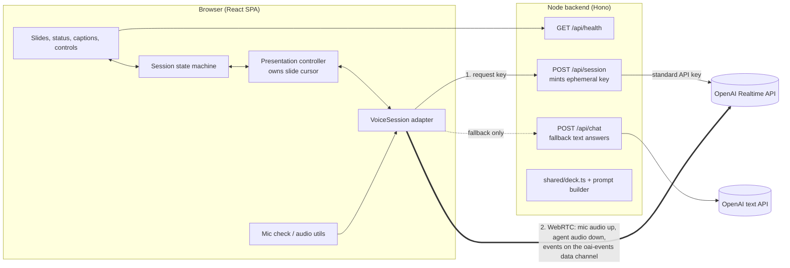

# Architecture: Voice Presentation Agent

> How the prototype is built. Product behaviour, states and targets are defined in [product-brief.md](product-brief.md), and this document refers to its sections as "brief §N".
> Key decisions are recorded in [decisions/](decisions/). Start with [ADR 0001](decisions/0001-realtime-voice-architecture.md).

## 1. Context and constraints

- **Optimise for interaction quality** over breadth. The hard targets (brief §9), measured in the browser from what the reviewer does to what they hear: Ava's audio stops within ≤ 150 ms of a talk press (phase 1) or ≤ 300 ms of the reviewer starting to speak (phase 2), and the first answer audio arrives at p50 ≤ 1.5 s.
- **Lightweight.** One small Node backend and one React single-page app. No database, no auth, no media server.
- **Reviewer-first.** One `npm install` and `npm run dev` plus a single API key. Desktop Chrome is the primary target, and current Edge, Safari and Firefox should work.
- **Never a dead end** (brief §10). Every failure has a working next step, and the demo can finish without a mic, and even without the realtime voice service.

## 2. System overview



- **Audio and events go straight from the browser to OpenAI** over WebRTC, so no media passes through our server. WebRTC gives us Opus encoding, jitter buffering and the browser's echo cancellation.
- **The backend does three things.** It keeps the API key secret, builds the session config (instructions, tools, voice and turn detection) from the shared deck, and serves the fallback text endpoint.
- **The deck is code** (`shared/deck.ts`), imported by both sides. The client renders slides from it, and the server builds the agent's grounding from it.

## 3. Voice stack

**OpenAI Realtime API over WebRTC, behind a provider-neutral `VoiceSession` adapter.** The rationale and the alternatives considered are in [ADR 0001](decisions/0001-realtime-voice-architecture.md).

| Setting | Value (env-overridable) | Why |
|---|---|---|
| Model | `OPENAI_REALTIME_MODEL`, default `gpt-realtime-2.1` | Speech-to-speech, so no separate transcription and speech-synthesis steps add latency. `gpt-realtime` is deprecated (shutdown 2027-01-20) and maps to `gpt-realtime-2.1`. |
| Voice | `OPENAI_REALTIME_VOICE`, default `marin` | A calm, clear voice that suits the persona (brief §6). The voice can't change once the session has produced audio. |
| Turn detection | **Phase 1 (tap-to-talk):** `null`, and the client commits each turn. **Phase 2+ (hands-free):** `semantic_vad`, `interrupt_response: true`, **`create_response: false`** | Tap-to-talk gives clean, explicit turns first ([ADR 0003](decisions/0003-turn-taking-tap-to-talk-first.md)). Hands-free adds server-side barge-in, with semantic end-of-turn to reduce cut-offs mid-thought. `create_response` stays off so the client remains the only creator of responses (§5.1). |
| Input transcription | `gpt-4o-mini-transcribe` | Captions of what the reviewer said (brief §7.4). Transcription runs asynchronously, so the reviewer's caption can arrive after Ava starts answering. |
| Transport | WebRTC (`/v1/realtime/calls`, SDP exchange) | Lowest latency in the browser, and the server truncates unplayed audio on interruption. |
| Session limit | 60 minutes per Realtime session | Treated as a planned reconnect (§10.2). |

## 4. The `VoiceSession` adapter

The rest of the app never sees a provider-specific event. Everything goes through this interface (`web/src/voice/types.ts`):

```ts
export interface VoiceSession {
  connect(opts: { mic: MediaStream | null; signal?: AbortSignal }): Promise<void>;
  close(): void;

  /** Speak one scripted narration segment (client-driven cursor, §6). */
  narrate(req: NarrationRequest): void;
  /** Typed question (text mode or chip click). Interrupts current speech. */
  sendUserText(text: string): void;
  /** Stop speaking now: cancel the response and drop queued audio. */
  interrupt(): void;
  /** respond=false for resume_presentation: the client narrates, the model must not speak again. */
  sendToolResult(callId: string, output: unknown, opts: { respond: boolean }): void;
  setMicEnabled(enabled: boolean): void;

  /** Tap-to-talk: open a user turn (interrupts the agent), then send or cancel it. */
  beginUserTurn(): void;
  endUserTurn(opts?: { cancel?: boolean }): void;
  /** Switch between explicit turns and server voice detection (phase 2+). */
  setTurnMode(mode: TurnMode): void;

  /** The agent's audio stream, for the waveform visualiser. */
  readonly agentAudio: MediaStream | null;
  on(listener: (e: VoiceEvent) => void): () => void;
}

export type VoiceEvent =
  | { type: "connected" }
  | { type: "disconnected"; reason: "network" | "server" | "closed" }
  | { type: "user_speech_started" }
  | { type: "user_speech_stopped" }
  | { type: "user_transcript"; itemId: string; text: string; final: boolean }
  | { type: "response_started"; responseId: string; tag: ResponseTag }
  | { type: "agent_audio_started"; responseId: string }
  | { type: "agent_audio_stopped"; responseId: string; interrupted: boolean }
  | { type: "agent_transcript"; responseId: string; delta: string }
  | { type: "tool_call"; responseId: string; callId: string; name: ToolName; args: unknown }
  | { type: "response_done"; responseId: string; status: "completed" | "cancelled" | "failed" }
  | { type: "error"; code: VoiceErrorCode; message: string; fatal: boolean };

export type ResponseTag =
  | { kind: "narration"; slideId: SlideId; segment: number }
  | { kind: "answer" };

export type TurnMode = "tapToTalk" | "handsFree";
```

| Implementation | Use |
|---|---|
| `OpenAIRealtimeSession` | The normal path. |
| `FallbackSpeechSession` | Used when the realtime service is unreachable (§10). `/api/chat` produces the text, and the browser's `speechSynthesis` speaks it. |
| `FakeVoiceSession` | Scripted events for unit tests and Playwright tests. |

**How OpenAI events map to adapter events** (inside `OpenAIRealtimeSession`):

| OpenAI (data channel) | Adapter |
|---|---|
| `input_audio_buffer.speech_started` / `speech_stopped` | `user_speech_started` / `user_speech_stopped` |
| `conversation.item.input_audio_transcription.delta` / `.completed` | `user_transcript` |
| `response.created` (tag read from `response.metadata`) | `response_started` |
| `output_audio_buffer.started` / `stopped` / `cleared` | `agent_audio_started` / `agent_audio_stopped` |
| `response.output_audio_transcript.delta` | `agent_transcript` |
| `response.function_call_arguments.done` | `tool_call` |
| `response.done` | `response_done` |
| `error`, `RTCPeerConnection` state changes, data channel `close` | `error` / `disconnected` |

The adapter's operations map to OpenAI client events:

| Adapter call | OpenAI client events |
|---|---|
| `narrate()` | `response.create` with per-response `instructions` (full persona + guardrails + script, §7), `tool_choice: "none"` and `metadata` |
| `sendUserText()` | `conversation.item.create` (`input_text`), then `response.create` |
| `interrupt()` | `response.cancel` (only if a response is active) + `output_audio_buffer.clear` (only if audio is playing). Per the WebRTC guide, the clear also truncates the assistant item to what was played. |
| `sendToolResult(callId, output, { respond })` | `conversation.item.create` (`function_call_output`), then `response.create` **only if `respond` is true** (§5.1) |
| `beginUserTurn()` | Mute the `<audio>` element locally (instant), `input_audio_buffer.clear`, enable the mic track. The cancel is deferred (§9). |
| `endUserTurn()` | Disable the mic track after a ~150 ms tail, then `input_audio_buffer.commit` + `response.create`. With `cancel`, only `input_audio_buffer.clear`. |
| `setTurnMode()` | `session.update` with `turn_detection` (`null`, or `semantic_vad`) |

The adapter only **sends** what the controller asks for. It never decides on its own to create a response (§5.1).

> Verified against the OpenAI docs on 2026-10-26: `/v1/realtime/client_secrets`, `/v1/realtime/calls`, the `oai-events` channel, `marin`, `semantic_vad` fields, `response.output_audio_transcript.delta`, response `metadata`, `output_audio_buffer.clear` (WebRTC only, truncates). **Still to verify in the first spike** (the API reference could not be read): whether response-level `instructions` replace or extend the session instructions; whether `output_audio_buffer.*` server events carry `response_id`; the exact error when a second response is created while one is active; and whether `response.cancel` with nothing active returns an error. Pin all event names in one file (`openai/events.ts`) so any rename is a one-line fix.

## 5. Client state machine

There is one machine (XState v5, in `web/src/machine/session.ts`). It is the single source of truth for status, captions and which controls are enabled (brief §8). It has **two parallel regions**. The `agent` region drives the status indicator, and the `presentation` region is the slide cursor.

```
setup:  landing → micCheck → ready ─┐
        landing → (continue by typing) ─┤
                                       ▼
live (parallel)
 ├─ connection: connecting → connected ⇄ reconnecting → failed
 ├─ voice:      live | backup | offline (§10.3–10.4)
 ├─ agent:      idle | listening | thinking | speaking | paused(reason: user | typing)
 ├─ input:      voice | text            (text = mic denied/absent/lost/muted-by-choice)
 ├─ turnMode:   tapToTalk | handsFree   (phase 1 ships tapToTalk only, ADR 0003)
 └─ presentation: narrating(slide, segment) | answering | awaitingResume | finished
ended   (End pressed: session closed, mic released)
```

`presentation` keeps its value while `agent = paused`, so Resume knows what to continue. `answering` lasts from the user turn being sent until that answer's `response_done`.

**Status label**, derived from the regions in this priority order:

1. `connection = connecting | reconnecting` → *Connecting…* / *Connection lost — reconnecting…*
2. A blocking error (`mic_denied`, `response_timeout`, `autoplay_blocked`, `rate_limited`, `server_error`, `connection = failed`) → its specific message + action (§10.1)
3. `voice = offline` → *You're offline — questions are paused*
4. `agent = paused(typing)` → *Paused while you type*
5. `agent = paused(user)` → *Paused — press Resume or P*
6. `agent = speaking` → *Speaking — hold Space to interrupt*
7. `agent = thinking` → *Thinking…* (*Still working…* after 4 s, an error after 10 s)
8. `agent = listening` → *Listening…*
9. `presentation = finished` → *Any final questions? Hold Space*
10. `input = text` or `voice = backup` → *Type your question below* (with a *Backup voice* tag when `voice = backup`)
11. `agent = idle`, `turnMode = tapToTalk` → *Hold Space or tap to talk*
12. `agent = idle`, `turnMode = handsFree` → *Listening for you…*

**Key transitions**

| Event | Effect |
|---|---|
| Talk pressed (`Space` down, or orb tap) | `beginUserTurn()`, `agent → listening` within 100 ms. If narrating, record the cursor as `interruptedAt` (unless one is already held, see §6.4). Allowed in any state except `connecting`, `reconnecting`, `failed`, `offline` (those show a hint). If a previous answer is still `thinking`, it is cancelled. |
| Talk released (`Space` up, or second orb tap) | ≥ 300 ms: `endUserTurn()`, `agent → thinking`, `presentation → answering`. < 300 ms: accidental, see §9. |
| Window `blur` / `visibilitychange` while holding | Same as release: send if ≥ 300 ms, otherwise cancel. |
| `Esc` while holding | `endUserTurn({ cancel: true })`, return to the previous state. |
| `user_speech_started` while speaking (hands-free) | The server already cancels and truncates. `agent → listening` at once, and if narrating, record `interruptedAt`. |
| `user_speech_stopped` (hands-free) | `agent → thinking`; the controller creates the answer response (§5.1). |
| `agent_audio_started` | `agent → speaking` |
| `response_done` (completed) for a narration | Next segment (§6.2). |
| `response_done` (completed) for an answer | `awaitingResume`, or back to `finished` if the talk had finished. |
| `tool_call goto_slide` | Validate it, change the slide, return the tool result (§6.3). |
| `tool_call resume_presentation` | Return `{ ok: true }` with `respond: false`, then `awaitingResume → narrating(interruptedAt)`. In `finished`, ignored. |
| First keystroke in the question box while speaking or narrating | `agent → paused(typing)`: mute output locally and `interrupt()` (§6.5). |
| Question box cleared, or `Esc` in it, or blur while empty | Resume as from `paused(user)`. |
| Typed question sent | `sendUserText()`, `agent → thinking`, `presentation → answering`. |
| `Stay here` (button, `S`) | Clear `returnTo`; the cursor moves to the current slide's segment 0 for the next resume. |
| `End` (button, `Shift+E`) | `interrupt()`, one closing line, then `close()`, stop all mic tracks, `→ ended`. |
| `disconnected` | `connection → reconnecting` (§10.2) |

Captions are not a separate store. They are a selector over the machine's transcript log, so they cannot disagree with the status.

### 5.1 Response ownership

Several things can lead to `response.create`: the narration loop, a typed question, a released talk turn, a tool result, and (in hands-free) the end of the reviewer's speech. To prevent duplicate or overlapping answers:

1. **Only the presentation controller creates responses.** Adapter methods send what they are told; the server never auto-creates (`create_response: false`).
2. **At most one response is active.** The controller records `activeResponseId` on `response_started`. Before creating a new response it sends `interrupt()` if one is active and waits for that response's `response_done` (status `cancelled`) before sending `response.create`. The waiting time is short and the reviewer already hears silence because output was cleared.
3. **Tool results decide whether to respond:**

| Tool | Response had audio already? | `respond` |
|---|---|---|
| `goto_slide` | No (tool call came first, the usual case) | `true`: the answer audio comes in the follow-up response |
| `goto_slide` | Yes | `false` |
| `goto_slide` with an invalid id | Either | `true`, with an error output the model can recover from |
| `resume_presentation` | Either | `false`: the client narrates |

### 5.2 Stale events

After `interrupt()`, events from the cancelled response can still arrive (transcript deltas, `response_done`, tool calls, audio-buffer events).

- Every adapter event that belongs to a response carries `responseId`. Events whose `responseId` is not `activeResponseId` are dropped (and logged when `?debug=1`).
- Tool calls from a cancelled or inactive response are ignored and not answered.
- On interrupt, the active caption line is closed with a dash and later deltas for that response are ignored.
- If `output_audio_buffer.*` events turn out not to carry a response id (§4 note), the adapter attributes them to the latest `response.created`.

### 5.3 Timers

Every timer is an XState delayed transition on the state that owns it, so leaving the state cancels it.

| Timer | Owner state | Fires | Cancelled by |
|---|---|---|---|
| Accidental-press window, 300 ms | `listening` (tap) | Commits to a real turn: sends the deferred cancel (§9) | Release before 300 ms |
| Mic tail, 150 ms | `listening` → sending | Disables the track, commits | — |
| Orb-tap auto-send, 30 s | `listening` (orb tap) | Sends the turn | Second tap, `Esc` |
| Thinking warning, 4 s / timeout, 10 s | `thinking` (restarts on each new response in the turn, including after a tool result) | *Still working…* / `response_timeout` | `agent_audio_started`, interrupt |
| Resume window, 1.5 s | `awaitingResume` (paused while `agent = paused` or `listening`) | Resume narration | Any talk press, keystroke, or new question |
| False-interruption fallback, 1.5 s | `thinking` after a turn with an empty or < 2-character transcript | Resume narration | A response starting |
| Peer `disconnected`, 3 s | `connected` | `connection_lost` | Peer back to `connected` |
| Mic check silence, 6 s | `micCheck` | Help options | Speech detected |

## 6. Presentation controller: client-driven cursor

The central design choice is that **the browser owns where we are in the talk, and the model never decides what comes next in the narration.** The model speaks the segment it is given, answers questions, and asks to change slides through tools. Resume, reconnect, pause and the fallback all depend on this (see ADR 0001).

### 6.1 Deck data model (`shared/deck.ts`)

```ts
export type SlideId = "intro" | "mechanism" | "uses" | "evidence" | "safety" | "future";

export interface Slide {
  id: SlideId;
  title: string;
  bullets: string[];            // on-screen text
  visual: VisualKey;            // inline SVG component key (scientific diagram, drawn to scale)
  segments: string[];           // spoken script, 1 sentence each (~4–7 s)
  facts: { id: string; text: string; sourceIds: string[] }[]; // grounding for Q&A, never shown verbatim
  sources: { id: string; label: string; url: string; accessed: string }[]; // shown in small print on the slide
  statusAsOf?: string;          // for approval/pipeline content that can change
  keywords: string[];           // hints for which questions map to which slide
}
```

Fact and source ids make every number traceable from the prompt back to a citation, and let a unit test fail if a fact references a missing source.

Short segments matter. Ava resumes from **the start of the segment she was interrupted in**, so at worst she repeats one or two sentences. Because the model is also told what was already heard, it bridges naturally ("As I was saying…") instead of repeating word for word. This is how the brief's rule to resume from where she was cut off (§6) is implemented.

### 6.2 Narration loop

1. `narrate({ slideId, segment, resume? })` sends `response.create` with `tool_choice: "none"` and response-level `instructions` built by the same prompt builder as the session (§7): persona and style, guardrails, then:
   > *Present this script naturally and close to its wording. Do not add facts. Script: "…". [If resuming: The listener already heard: "…". Bridge briefly, then continue.] [If returning: Announce: back to <title>.]*

   The full persona is repeated because response-level instructions may replace the session instructions for that response (to verify, §4).
2. The next segment is requested on the current segment's `response_done`, without a fixed delay. The response finishes generating before its audio finishes playing, so the next response's generation overlaps the tail of the current audio.
3. After the last segment of slide 6, Ava gives a recap and asks "Any final questions?", and presentation moves to `finished`.

Each narration is a normal response in the conversation, so the model keeps the context of what it has presented when it answers questions.

**Narration granularity is decided by measurement.** One response per sentence gives exact resume points but adds a round trip per sentence (about 21 per talk). If the measured silence between sentences exceeds the brief's p50 ≤ 600 ms target, switch to one response per slide: the script is sent whole, and on interruption the truncated transcript shows which sentence was reached, so resume still starts at the interrupted sentence. Whether a new response can be queued while the previous one's audio is still playing is checked in the first spike.

### 6.3 Tools (defined server-side in the session config)

| Tool | Args | Client behaviour |
|---|---|---|
| `goto_slide` | `slide_id: SlideId` (enum), `intent: "answer" \| "user_request" \| "stay"` | Validate it with Zod and show the slide right away. With `intent=answer`, set `returnTo = interruptedAt.slideId` **only if `returnTo` is not already set** (a follow-up that navigates again still returns to the original slide). With `user_request`, move the cursor to that slide's segment 0 and clear `returnTo`. With `stay` ("let's stay here"), clear `returnTo` like the Stay here button. Reply with `{ ok: true, slide_title }`. |
| `resume_presentation` | none | Called when the reviewer says "go on" or "continue", or when the turn was only a backchannel or noise ("mm-hm", a cough). Resume narration immediately. Ignored in `finished`. |

The instructions tell the model to **call `goto_slide` before speaking** when a question belongs to another slide, so the slide lands with the first words (brief §6). In practice that response contains only the tool call, so the answer audio comes from a second response after the tool result (§5.1). That extra round trip counts against the 1.5 s answer target and is measured separately (§9). If it is too slow, the fallback is to let the model speak a short lead-in ("Let me pull up the safety slide") in the same response as the call.

### 6.4 Resuming after an answer

After an answer's `response_done`, the presentation is in `awaitingResume`. If 1.5 s pass with no talk press, keystroke or new question:

- If `returnTo` is set, return to that slide, and the narration instructions include "Announce: back to <title>."
- Narrate from `interruptedAt` with the resume context.
- Clear `interruptedAt` and `returnTo` once that narration starts.

Rules for keeping the resume point correct:

- **Follow-up questions** inside the window restart it and keep `interruptedAt` and `returnTo`.
- **An interruption during a bridge** ("Back to…", "As I was saying…") keeps the original `interruptedAt`; it is not overwritten by the bridge.
- **Questions after `finished`** return to `finished` with no narration. If the answer jumped slides, Ava returns to slide 6 and says nothing more than the return line.
- **Answer cancelled by Pause:** Resume offers the question again ("Ask again" in the notice) rather than continuing narration.

### 6.5 Manual controls

| Control | Effect |
|---|---|
| ← / → , `1`–`6`, slide dots | `interrupt()`, move the cursor to that slide's segment 0, clear `returnTo` and `interruptedAt`, narrate. While paused: change the slide and stay paused. Ignored past the first or last slide. |
| Talk (hold `Space`, or tap the orb to start and tap again to send) | Tap-to-talk turn input (§9). |
| Pause (`P`) | Mute output locally, `interrupt()`, mute the mic track, `agent → paused(user)`. Resume re-narrates the current segment from its start (Realtime audio can't be paused mid-word). |
| Typing in the question box | `agent → paused(typing)` on the first keystroke, same mechanics as Pause. Send → answer. Clear/`Esc`/blur-while-empty → resume. |
| Stay here (button, `S`) | Clear `returnTo` (§6.3). |
| End (button, `Shift+E`) | §5 key transitions. |
| Mute mic (`M`, phase 2+) | `track.enabled = false` and `input → text`. The session stays up. |
| `/` | Focus the question box. |
| `R` | Trigger the Retry action of the visible error. |
| `Esc` | Cancel a held turn; otherwise clear the question box or close a notice. |
| `?` | Show the shortcut list. |

Every control has a shortcut or is reachable with `Tab`. Shortcuts are handled by one global `keydown` listener in capture phase; they are ignored while focus is in the question box (except `Esc` and `Enter`), and `e.repeat` is ignored.

## 7. Agent prompt and grounding

The server builds this in `server/src/prompt.ts` from `shared/deck.ts`:

1. **Persona and style:** Ava, a medical educator. Answers run 1–3 sentences and offer more detail rather than giving it unasked (brief §6).
2. **Deck map:** each slide's id, title and keywords, so `goto_slide` targets are obvious.
3. **Facts:** all slide `facts` with their ids and source labels. The rule is to answer from these first, to keep numbers exactly as given (with trial, dose and duration), and to flag anything else as general background.
4. **Guardrails:**
   - **Personal medical questions:** give general information, then refer the reviewer to a clinician.
   - **Off-topic questions:** one sentence, then a bridge back.
   - **Uncertainty:** say "I don't know" rather than guess.
   - **Brands:** use generic names first.
5. **Tool rules:** when to call `goto_slide` (and with which intent) and when to call `resume_presentation`.

The session instructions hold items 1–5. The prompt builder exposes one function per use, so every path gets the same persona and guardrails:

| Use | Built from |
|---|---|
| Session instructions (Q&A) | Items 1–5 |
| Narration response instructions (§6.2) | Items 1 and 4, plus the script, resume and return lines. No tools. |
| Reconnect seed (§10.2) | A `system` message: current slide and segment, slides already covered, `returnTo`, the last 3 Q&A pairs, "Do not re-greet." |
| `/api/chat` (backup voice, §10.3) | Items 1–5, with tools expressed as structured output |

The total size stays well within limits: the detailed deck is about 4–6k tokens. A prompt-builder snapshot test plus a set of about 25 golden questions (on-deck, cross-slide, personal advice, off-topic, out-of-deck medical, trick numbers) with expected slide and must/must-not phrases guard the grounding rules.

## 8. Audio

- **Mic capture:** `getUserMedia({ audio: { echoCancellation: true, noiseSuppression: true, autoGainControl: true, deviceId } })`. One stream is shared by the mic check and the session, so permission is asked once (brief §7.2–7.3).
- **Mic check:** an `AudioContext` + `AnalyserNode` measures RMS level. Speech is detected when the level stays above the threshold for about 300 ms. The 6 s no-input timeout leads to the help options. `enumerateDevices()` fills the picker after permission is granted, and `devicechange` keeps it up to date.
- **Agent audio:** the remote WebRTC track plays through an `<audio autoplay>` element. A second `AnalyserNode` on `agentAudio` drives the speaking waveform. The Start click unlocks autoplay. If `play()` still rejects, a "Tap to enable sound" prompt appears.
- **Text mode with no mic:** the peer connection is created with `addTransceiver("audio", { direction: "recvonly" })` and `turn_detection: null`, so the agent still speaks.
- **Mic lifecycle:** the mic track is enabled only while a turn is held (phase 1). The browser's recording indicator stays on for the session, and turns off on End. A track `ended` event or the active device disappearing on `devicechange` switches `input → text` with the notice "Your microphone disconnected". Picking another device mid-session uses `RTCRtpSender.replaceTrack`, with no reconnect.
- **Local output mute:** the `<audio>` element can be muted instantly on the client. This is what makes the ≤ 150 ms stop target independent of network round trips (§9).
- **Reduced motion:** the visualisers fall back to static icons (brief §11).

## 9. Interruptions

Turn-taking ships in phases ([ADR 0003](decisions/0003-turn-taking-tap-to-talk-first.md)): **tap-to-talk**, then **hands-free**, then a **hybrid** toggle.

**Phase 1: tap-to-talk mechanics** (session `turn_detection: null`)

1. **Press** (`Space` keydown, or orb `pointerdown`): `beginUserTurn()` mutes the `<audio>` element at once (Ava is silent within a frame), clears the input buffer, and enables the mic track. The status shows *Listening…* right away. The response is **not** cancelled yet.
2. **At 300 ms still held:** this is a real turn. `interrupt()` sends `response.cancel` + `output_audio_buffer.clear`, which truncates Ava's message to what was played. The `<audio>` element is unmuted for the answer.
3. **Release** (`Space` keyup, or second orb tap): keep the mic open for a ~150 ms tail so the last word isn't clipped, then disable the track, `input_audio_buffer.commit` and `response.create` (§5.1). Input transcription runs on the commit to fill the captions.
4. **Accidental press (released under 300 ms):** `input_audio_buffer.clear`, unmute. Ava has kept generating, so she continues having lost about 300 ms of speech, instead of re-narrating the whole sentence. If her response ended during the press, narration continues normally.
5. **Guards:**
   - An orb-tap turn auto-sends after 30 s.
   - Key auto-repeat is ignored; `blur` / `visibilitychange` ends the turn (§5).
   - On touch, the orb uses pointer events: hold ≥ 300 ms = hold-to-talk, a short tap = tap-to-start; `pointercancel` cancels.
   - A turn that turns out to be empty (no transcript or < 2 characters) resumes narration after 1.5 s if no response has started (§5.3). This applies in phase 1 as well as phase 2.
6. **Truncation:** the WebRTC guide states that `output_audio_buffer.clear` truncates the conversation. QA still checks it once; `conversation.item.truncate` is the fallback if it doesn't.

**Phase 2+: hands-free** uses the rows below.

| Concern | Handling |
|---|---|
| Detecting barge-in | Server `semantic_vad` raises `speech_started`, and the server cancels the in-flight response. Over WebRTC the server truncates the agent's message to the audio actually played, so the history reflects only what the reviewer heard. |
| Fast visual feedback | The status flips to *Listening…* on `speech_started`, without waiting for audio to stop. |
| Self-interruption (echo) | Browser echo cancellation, plus a headphone tip on the mic-check screen. If echo still triggers in testing, lower the `semantic_vad` eagerness. Tap-to-talk remains available as the fallback (ADR 0003). |
| False interruptions (cough, "mm-hm") | The model calls `resume_presentation` (§6.3). If an empty or under-2-character transcript produces no response within 1.5 s, the client resumes narration anyway. |
| Typed interruption | `interrupt()` (`response.cancel` + `output_audio_buffer.clear`), then send the text. |

**What we measure** (the debug overlay, `?debug=1`). Server events arrive after network and VAD delay, so they don't show what the reviewer experiences. All metrics are measured locally, using `AnalyserNode`s on the mic and on `agentAudio`:

| Metric | Start | End |
|---|---|---|
| Barge-in (tap) | `keydown` / `pointerdown` | Agent audio level below the silence threshold |
| Barge-in (hands-free) | Mic level crosses the speech threshold | Agent audio level below the silence threshold |
| Response latency | `Space` up (tap) or mic level drops below threshold (hands-free) | First non-silent agent audio frame |
| Slide sync | First audible answer frame | Slide transition finished |
| Narration gap | Agent audio goes silent at the end of a sentence | Next non-silent frame |
| Tool round trip | `goto_slide` received | Follow-up response's first audio |

The overlay shows p50 and p90 per metric, and a "Copy as JSON" button so the README can quote measured numbers. Each event is also logged with `performance.now()`.

## 10. Failures and recovery

### 10.1 Error taxonomy → UI (brief §10)

Four failure classes behave differently, because the backend is not in the audio path:

| Class | Live session | `/api/session` | `/api/chat` | Result |
|---|---|---|---|---|
| **Input** (mic) | Up | Up | Up | Text mode; live voice continues |
| **Voice service** (OpenAI Realtime) | Down | Up | Up | Reconnect, then backup voice |
| **Backend** | Unaffected while connected | Down | Down | Nothing visible until a reconnect is needed; then narration continues with local browser speech and questions are paused |
| **Network** (all) | Down | Down | Down | Offline mode (§10.4) |

| Code | Class | Source | UI | Recovery |
|---|---|---|---|---|
| `mic_denied` | Input | `NotAllowedError` | Steps to re-enable the mic for this browser | Retry, or text mode |
| `mic_not_found` | Input | `NotFoundError` / no devices | "No microphone found" | Device picker, Retry, or text mode |
| `mic_silent` | Input | Mic check timeout | Mute/device tips | Picker, Retry, or text mode |
| `mic_lost` | Input | Track `ended`, or active device removed | "Your microphone disconnected" | Automatic text mode; picker; Try microphone again |
| `not_configured` | Backend | `/api/health` → `configured: false`, or OpenAI returns 401 when minting | Banner on the landing screen with the README link | Fix `.env` |
| `quota` | Backend | OpenAI returns 429 `insufficient_quota` when minting | "The API key has no credit left" | Fix billing |
| `backend_unreachable` | Backend | `/api/health` or `/api/session` fetch fails while `navigator.onLine` | "Our server isn't responding" | Retry; local narration continues |
| `session_failed` | Voice service | SDP exchange fails, or OpenAI 5xx when minting | *Can't connect to the voice service* | 2 automatic retries (0.5 s, 2 s), then Retry or **Continue with backup voice** |
| `connection_lost` | Voice service | Peer connection `failed`, or `disconnected` for more than 3 s, or data channel closed | *Connection lost — reconnecting…* | §10.2 |
| `offline` | Network | `offline` event, or fetches fail with `navigator.onLine === false` | *You're offline — questions are paused* | §10.4; recovers on `online` |
| `response_timeout` | Voice service | `thinking` for more than 10 s | *That took too long* | Retry the last question |
| `autoplay_blocked` | — | `audio.play()` rejects | *Tap to enable sound* | One click |
| `rate_limited` / `server_error` | Voice service | `error` event | Plain-language message | Retry |

Expected protocol errors are not shown to the reviewer: `response.cancel` with no active response, and committing an empty input buffer, are logged in debug mode only. `/api/health` checks only that a key is present; a bad key is caught when `/api/session` mints and gets a 401.

### 10.2 Reconnect

A dropped Realtime session can't be reattached, so reconnect means a new session with re-seeded context.

1. Keep the slide on screen and the cursor as it is. Drop any turn being held (notice: "That question was lost in the reconnect — ask again").
2. Get a new client secret and a new peer connection, with the same backoff as `session_failed`.
3. Seed context with one `conversation.item.create`, role `system`, built by the prompt builder (§7).
4. **Restore the state the presentation was in:**

| State before the drop | After reconnect |
|---|---|
| `narrating` | Narrate from the interrupted segment with "We're back" resume context |
| `paused` | Stay paused; nothing is spoken until Resume |
| `answering` | Notice with **Ask again** (resends the question); no narration until it is answered or dismissed |
| `awaitingResume` | Resume as normal (§6.4) |
| `finished` | Stay finished, silent |

The 60-minute session limit is handled the same way, triggered by a timer at 55 minutes and performed at the next `awaitingResume` or between narration segments.

### 10.3 Backup voice (voice service unreachable, backend reachable)

If reconnecting fails, the reviewer can **Continue with backup voice**, which swaps in `FallbackSpeechSession` (`voice = backup`):

- **Narration:** the browser's `speechSynthesis` reads the segment scripts directly. This works because the client owns the cursor and the scripts.
- **Questions:** typed questions go to `POST /api/chat`. It uses the same prompt builder with an OpenAI text model (`OPENAI_CHAT_MODEL`) and structured output that mirrors the tools: `{ answer: string, goto_slide?: { slide_id: SlideId, intent: "answer" | "user_request" | "stay" }, resume?: boolean }`. The answer is spoken with `speechSynthesis` and captioned, and `returnTo` works as in live mode.
- **Interruption:** `speechSynthesis.cancel()`. Typing pauses with `speechSynthesis.pause()`.
- **Status:** the label reads *Backup voice* so the downgrade is honest, and a "Try live voice again" button stays visible. The client also retries live voice in the background every 30 s.

### 10.4 Offline (no network)

- Narration continues with `speechSynthesis`, preferring a voice with `localService === true` (some default Chrome voices are network-backed).
- The question box and talk control are disabled with "You're offline — questions are paused".
- On the `online` event, the client reconnects (§10.2) and returns to live voice on the same slide.

## 11. Security

- **Key handling:** `OPENAI_API_KEY` lives only in the server `.env`. The browser only ever receives a **short-lived client secret**, created by `POST /v1/realtime/client_secrets` with the full session config built server-side and `expires_after` of 60 s. The expiry limits only session creation (the session itself continues), so every reconnect mints a new secret.
- **Token-route abuse:** `/api/session` and `/api/chat` share an in-memory per-IP rate limit (for example 10/min) and a request body size cap.
- **CORS** is restricted to the app origin. In dev, Vite proxies `/api`, so everything is same-origin.
- **Nothing stored:** no audio, transcripts or personal data are kept on the server. Transcripts live only in browser memory for the session.
- **Validation:** tool arguments and `/api/chat` input are validated with Zod. Unknown slide ids are rejected with a tool error the model can recover from.
- **Known prototype limit:** a client holding the secret can send its own `session.update` (the docs confirm client config overrides). That's acceptable here. The fix is a server sideband connection (`wss://api.openai.com/v1/realtime?call_id=…`, using the call id from the SDP response's `Location` header), which is documented for WebRTC today and works from this Node server; it does not depend on the production migration in ADR 0002.
- **Logging:** the server logs never include keys, transcripts or SDP.

## 12. Tech stack

| Layer | Choice | Why |
|---|---|---|
| Frontend | Vite + React 18 + TypeScript | Fast dev loop and a small build |
| Styling and motion | Tailwind CSS + Framer Motion | Polished slide transitions and status animations with little code |
| State | XState v5 | Parallel regions and timeouts are explicit and testable |
| Validation | Zod (shared) | Tool arguments, API payloads |
| Backend | Node 20 + Hono (TypeScript) | A small server with three routes. One toolchain and shared types for the prototype. Production moves to Python (FastAPI + Pipecat), see [ADR 0002](decisions/0002-backend-node-now-python-for-production.md). |
| Voice | OpenAI Realtime (WebRTC), plain `RTCPeerConnection` | No SDK lock-in, so the adapter stays thin |
| Tests | Vitest + Playwright | Unit tests for the machine and controller, end-to-end tests with a fake mic |

## 13. Repository layout

```
package.json            # npm workspaces; `dev` runs web + server concurrently
.env.example            # OPENAI_API_KEY, OPENAI_REALTIME_MODEL, OPENAI_REALTIME_VOICE, OPENAI_CHAT_MODEL, PORT
shared/
  deck.ts               # slides, scripts, facts, sources
  schema.ts             # Zod schemas: tools, /api/chat
server/
  src/index.ts          # Hono app, rate limit, static SPA in prod
  src/session.ts        # POST /api/session → ephemeral key
  src/chat.ts           # POST /api/chat (fallback)
  src/prompt.ts         # instructions + tool definitions from deck
web/
  src/voice/            # types.ts, openai/, fallback/, fake/
  src/machine/          # session machine + selectors
  src/presentation/     # cursor controller, narration/resume logic
  src/audio/            # mic check, meters, device list
  src/components/       # Landing, MicCheck, Stage, Slide, StatusOrb, Captions, Controls
  src/slides/visuals/   # inline SVG diagrams
  e2e/                  # Playwright specs
```

## 14. Running and deploying

- **Local:** `npm install`, copy `.env.example` to `.env`, add the key, then `npm run dev`. Vite runs on `:5173` and proxies `/api` to Hono on `:8787`.
- **Production build:** `npm run build && npm start` runs one Node process that serves the built SPA and the API. It deploys as is to Render, Fly or Railway. Mic access requires HTTPS, which those hosts provide.
- **Hosted URL for reviewers:** not planned. The submission is a GitHub repo link or a zip, and reviewers run it locally with their own key (`localhost` counts as a secure context, so the mic works over plain HTTP). Requirements: Node 20+, npm 10+, desktop Chrome.

## 15. Testing

| Layer | What |
|---|---|
| Unit (Vitest) | Machine transitions, especially interruptions during narration, a tool call during an answer, resume and `returnTo`, follow-ups, questions after `finished`, reconnect in each state (§10.2), stale events from a cancelled response, at most one active response, and backup-voice swap. The controller is driven by `FakeVoiceSession` event scripts. |
| Unit | Status priority selector, Zod tool validation, prompt builder snapshot, every fact references an existing source |
| Golden questions | About 25 questions against the real API with expected slide and must/must-not phrases (§7) |
| E2E (Playwright) | Chrome flags `--use-fake-ui-for-media-stream --use-fake-device-for-media-stream`: the mic check passes, and Start leads to *Connecting*. With a fake adapter injected: hold `Space` → listening and agent audio stops, release → thinking, a short tap → narration continues, typing → paused, chip question → slide change, mic denied → text mode, connection drop → recovery without a reload, offline → local narration, and every shortcut in brief §9. |
| Manual QA | The brief §12 acceptance checks, run against the real API on laptop speakers and on headphones. Latency is recorded from the debug overlay. |

## 16. Decision log

| ADR | Decision | Status |
|---|---|---|
| [0001](decisions/0001-realtime-voice-architecture.md) | OpenAI Realtime over WebRTC behind a `VoiceSession` adapter, with a client-driven slide cursor | Accepted |
| [0002](decisions/0002-backend-node-now-python-for-production.md) | Node + Hono backend for the prototype; Python (FastAPI + Pipecat) for production, with a staged scaling path | Accepted |
| [0003](decisions/0003-turn-taking-tap-to-talk-first.md) | Turn-taking in phases: tap-to-talk, which meets the interrupt requirement, then hands-free (recommended stretch goal), then a hybrid toggle | Accepted |
| — | Hosting: local only, submitted as a repo link or zip (§14) | Decided |
| — | Narration granularity: per sentence or per slide, by measured gap (§6.2) | Decided by first measurement |
